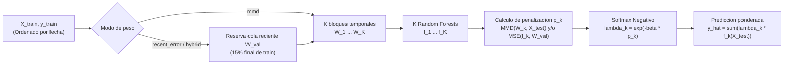

# DriftAdaptiveForest


Framework modular en Python (compatible con **Scikit-Learn** y **Optuna**) para mitigar **Data Drift** ($P(X)$ cambia en el tiempo) y **Concept Drift** ($P(Y \mid X)$ cambia en el tiempo) en problemas de **regresión temporal** usando algoritmos basados en árboles.

---

## Por qué falla un Random Forest clásico ante Drift

Entrenar un `RandomForestRegressor` clásico sobre datos temporales (incluso usando `sample_weight` exponencial) presenta dos limitaciones estructurales:
1. El **bootstrap uniforme** sigue mezclando muestras históricas obsoletas dentro de cada árbol, diluyendo el peso de las observaciones recientes.
2. Los árboles **no extrapolan** fuera del rango de entrenamiento y promedian regímenes pasados incompatibles con el presente cuando cambia $P(Y \mid X)$.

---

## Arquitectura de la Estrategia Implementada (`DriftRegressor`)

En lugar de mezclar todas las épocas en un solo bosque, `DriftRegressor` entrena un sub-bosque experto por cada bloque temporal y asigna **pesos dinámicos** en tiempo de inferencia según qué tan válido sigue siendo cada bloque frente al presente:



---

## Formulación Matemática

### 1. Datos Sintéticos con Drift Dual (`generate_data.py`)
Simula ingresos hospitalarios (`dias_estancia` como target no lineal sobre `edad`, `comorbilidad`, `severidad_ingreso` y `ocupacion_hospitalaria`) sobre el reloj normalizado $t_{\text{norm}} \in [0, 1]$:
* **Data Drift ($P(X)$):** Las medias y parámetros de forma de las covariables evolucionan con tendencia y ondas estacionales.
* **Concept Drift ($P(Y \mid X)$):** En `drift_type="both"`, una transición sigmoide centrada en $t_{\text{norm}} = 0.6$ cambia el protocolo clínico:

$$\alpha_t = \frac{1}{1 + \exp\big(-15(t_{\text{norm}} - 0.6)\big)}$$

$$y_t = (1 - \alpha_t)\,f_{\text{vieja}}(X_t) + \alpha_t\,f_{\text{nueva}}(X_t) + \epsilon_t$$

### 2. Pesos Dinámicos por Bloque (`block_ensemble.py`)
Dado un conjunto histórico dividido en $K$ ventanas contiguas $W_1, \dots, W_K$ con sub-bosques $f_1, \dots, f_K$:

* **Modo `"mmd"` (detecta Data Drift en $X$):**
  $$p_k = \max\Big(0,\; \widehat{\text{MMD}}^2\big(X_{W_k}^{\text{scaled}}, X_{\text{test}}^{\text{scaled}}\big)\Big)$$
* **Modo `"recent_error"` (detecta Concept Drift en $Y \mid X$):**
  $$e_k = \text{MSE}(f_k, W_{\text{val}}), \qquad p_k = \frac{e_k}{\bar{e} + \epsilon}$$
* **Modo `"hybrid"` (combina ambos con $\alpha \in [0, 1]$):**
  $$p_k = \alpha \frac{\text{MMD}^2_k}{\overline{\text{MMD}^2} + \epsilon} + (1 - \alpha) \frac{e_k}{\bar{e} + \epsilon}$$

En los tres modos, las penalizaciones se transforman en pesos convexos mediante **softmax negativo** y se combinan en la predicción final:

$$\lambda_k = \frac{\exp(-\beta \cdot p_k)}{\sum_{j=1}^{K} \exp(-\beta \cdot p_j)}, \qquad \hat{y}(x) = \sum_{k=1}^{K} \lambda_k \, f_k(x)$$

---

## Resultados Experimentales Observados

Evaluación temporal estricta (`4,000` filas iniciales para entrenamiento/CV, `1,000` filas futuras para test):

### Escenario A: Solo Data Drift moderado (`healthcare_drift.parquet`)
| Modelo | Configuración | RMSE (Test) | Hallazgo |
| :--- | :--- | :---: | :--- |
| **RF Clásico** | 100 árboles | **1.3073** | Al ser fija $f(X)$, aprovecha las 4,000 muestras juntas |
| **DriftRegressor (`mmd`)** | `n_blocks=5, beta=10` | 1.4761 | `beta=10` dejó 46% de peso a bloques viejos |
| **DriftRegressor (`mmd`)** | `n_blocks=5, beta=50` | 1.3874 | Colapsó bloques 1–3 al 10% total; mejora clara vs `beta=10` |

### Escenario B: Data Drift + Concept Drift (`healthcare_both_drift.parquet`)

**Comparativa base (`n_blocks=5, beta=15`):**
| Modelo | RMSE (Test) | Pesos asignados por bloque `[B1, B2, B3, B4, B5]` |
| :--- | :---: | :--- |
| **RF Clásico** | 6.4003 | *(Peso uniforme sobre toda la historia)* |
| **DriftRegressor (`mmd`)** | 5.9404 | `[0.1024, 0.1734, 0.1180, 0.2923, 0.3140]` |
| **DriftRegressor (`hybrid`)** | 5.8175 | `[0.0000, 0.0008, 0.0000, 0.2302, 0.7690]` |
| **DriftRegressor (`recent_error`)** | **5.0854** | `[0.0000, 0.0000, 0.0000, 0.0000, 1.0000]` |

**Comparativa optimizada con Optuna + `TimeSeriesSplit` (4 folds):**
| Modelo | RMSE | MAE | $R^2$ | Mejora en RMSE |
| :--- | :---: | :---: | :---: | :---: |
| **RF Clásico (Optuna)** | 6.3865 | 4.3541 | -0.9377 | — |
| **DriftRegressor (Optuna)** | **4.6901** | **3.2892** | **-0.0450** | **-26.6%** (-1.70 días) |

> **Conclusión clave:** Cuando solo cambia $P(X)$ levemente, el RF clásico aprovecha todo el histórico; pero cuando ocurre **Data + Concept Drift**, `DriftRegressor` supera ampliamente al RF clásico al aislar regímenes y colapsar el peso de las épocas obsoletas.

> **Advertencia:** los resultados de arriba corresponden a un solo escenario (el más favorable) y no incluyen líneas base de recencia. En el [benchmark ampliado](#benchmark-ampliado-16-datasets-y-líneas-base-de-recencia) un RF entrenado solo con datos recientes iguala o supera al `DriftRegressor` en la mayoría de los casos con concept drift, y el `DriftRegressor` es peor que el RF clásico cuando no hay concept drift.

---

## Benchmark ampliado: 16 datasets y líneas base de recencia

11 escenarios sintéticos (4–20 variables, distintos tipos de drift) y 5 datasets reales (Air Quality, Bike Sharing, Gas Sensor Drift, Beijing PM2.5, Electricity), con split 80/20 y walk-forward (6 reentrenamientos). Se añadieron dos líneas base de recencia, que el README original no tenía: un RF entrenado solo con el 20 % más reciente (`RF_ventana`) y un RF con pesos exponenciales (`RF_pesos_exp`). Detalle en [experiments/BITACORA.md](experiments/BITACORA.md), [CONCLUSIONES.md](CONCLUSIONES.md) y [MEJORAS.md](MEJORAS.md).

Error relativo = RMSE del modelo / RMSE del RF clásico (media geométrica). Menos de 1 = mejor que el RF clásico.

| Conjunto y protocolo | `AdaptiveDriftForest` | `RF_ventana` | `DriftRegressor` (mejor modo) |
| :--- | :---: | :---: | :---: |
| Sintéticos, walk-forward (semillas 0–2) | **0.809** | 0.839 | 0.965 |
| Sintéticos, walk-forward (semillas 3–5, validación) | **0.810** | 0.846 | 0.965 |
| Sintéticos, 80/20 (semillas 0–2) | **0.698** | 0.699 | 0.897 |
| Sintéticos, 80/20 (semillas 3–5, validación) | **0.677–0.691** | 0.701 | 0.898 |
| Reales, walk-forward | **0.983** | 1.049 | 1.020 |
| Reales, 80/20 | **0.919** | 1.004 | 0.990 |

**Hallazgos:**
- El `DriftRegressor` original supera al RF clásico solo con concept drift fuerte, y ahí un RF de ventana reciente iguala o lo supera. Sin concept drift, el `DriftRegressor` es peor que el RF clásico (hasta +29 % de error).
- `AdaptiveDriftForest` (ventanas recientes anidadas, penalización por error normalizado, reentrenamiento con la cola de validación y pesos fijos) supera al RF clásico en 10 de 11 escenarios sintéticos (Wilcoxon p = 0.002 con semillas 0–2 y p = 0.005 con semillas 3–5) y no pierde cuando no hay drift. También corrige el fallo de `predict` con una sola fila.
- En datos reales la ventaja es modesta y no es estadísticamente significativa (5 datasets).
- En concept drift **recurrente** (`friedman_recurring`) y en Electricity, el `DriftRegressor` original sigue siendo mejor.

**Limitaciones:** las semillas 3–5 usan los mismos 11 generadores con los que se diseñó `AdaptiveDriftForest`; validan frente a otro ruido, no frente a tipos de drift nuevos. Los datasets reales tampoco son una validación independiente. Aún no hay intervalos de incertidumbre ni tuning de `beta` para el modelo nuevo.

```python
from src.drift_adaptive_forest.models.adaptive_ensemble import AdaptiveDriftForest

modelo = AdaptiveDriftForest(weighting="error", beta=20.0, random_state=42)
modelo.fit(X_train, y_train)      # X ordenado en el tiempo (o pasar timestamps=)
modelo.predict(X_nuevo)           # funciona con una sola fila
modelo.weights_summary()          # p. ej. {'ventana_0.10': 1.0}
```

---

## Instalación y Uso Rápido

```powershell
# 1. Crear y activar el entorno virtual del proyecto
python -m venv venv_drift_forest
.\venv_drift_forest\Scripts\Activate.ps1

# 2. Instalar dependencias
pip install -r requirements.txt

# 3. Generar datos sintéticos (Data + Concept Drift)
python -m src.drift_adaptive_forest.data.generate_data

# 4. Probar DriftRegressor vs RF Clásico
python -m src.drift_adaptive_forest.models.block_ensemble

# 5. Ejecutar optimización temporal con Optuna
python -m experiments.tune_and_compare
```

---

## Estructura y Hoja de Ruta

```text
DriftAdaptiveForest/
├── data/raw/                              # Datasets sintéticos (.parquet)
├── experiments/
│   ├── tune_and_compare.py                # Benchmark y tuning con Optuna + TimeSeriesSplit
│   ├── benchmark_drift.py                 # Benchmark estático y walk-forward (sintético + real)
│   ├── synthetic_scenarios.py             # 11 escenarios sintéticos con distintos tipos de drift
│   ├── real_datasets.py                   # 5 datasets reales (UCI / OpenML)
│   ├── tune_benchmark.py                  # Tuning con Optuna en 10 datasets
│   ├── summarize_benchmark.py             # Tablas resumen (summary.md, summary_holdout.md)
│   ├── finance_data.py                    # Descarga Yahoo Finance + BCRPData (sin API key)
│   ├── finance_experiment.py              # Experimento de volatilidad con embargo y HAR / HAR-X
│   ├── graficar_analisis.py               # Figuras con la paleta CCDE (experiments/figuras/)
│   ├── BITACORA.md                        # Registro paso a paso del trabajo
│   └── results/                           # CSV de resultados y resúmenes
├── src/drift_adaptive_forest/
│   ├── data/generate_data.py              # Simulador clínico con Data y Concept Drift
│   ├── metrics/mmd.py                     # Estimador empírico de MMD^2 (RBF + heurística mediana)
│   └── models/
│       ├── block_ensemble.py              # Estrategia B: DriftRegressor compatible con sklearn
│       └── adaptive_ensemble.py           # AdaptiveDriftForest: ventanas recientes + pesos fijos
├── CONCLUSIONES.md                        # Diagnóstico del DriftRegressor original
├── MEJORAS.md                             # AdaptiveDriftForest y sus resultados
├── FINANZAS.md                            # Experimento de volatilidad en 13 series financieras
├── MACRO.md                               # Macro mensual FRED + EPU
├── MATRICULA.md                           # Demanda de matrícula universitaria (IPEDS)
├── ESPECIFICACION_PENDIENTES.md           # Críticas, tareas y reglas para continuar el desarrollo
├── paper/                                 # Documento académico (main.tex original y main_v2.tex)
├── requirements.txt
└── README.md
```

> `data/real/` (datasets reales descargados) no se versiona. Para recrearla, ver las URLs en `experiments/real_datasets.py`.

* [x] **Paso 1:** Generador sintético con Data Drift y Concept Drift (`generate_data.py`).
* [x] **Paso 2:** Estimador $\widehat{\text{MMD}}^2$ con kernel RBF y heurística de la mediana (`mmd.py`).
* [x] **Paso 3:** Estrategia B — `DriftRegressor` con modos `"mmd"`, `"recent_error"` y `"hybrid"` (`block_ensemble.py`).
* [x] **Paso 4:** Optimización y validación temporal con Optuna + `TimeSeriesSplit` (`tune_and_compare.py`).
* [x] **Paso 4b:** Benchmark ampliado (16 datasets, 2 protocolos, líneas base de recencia) y `AdaptiveDriftForest` (ver más abajo).
* [ ] **Paso 4c (Próximo):** Intervalos de incertidumbre (conformal adaptativo) y tuning de `beta` con validación temporal.
* [ ] **Paso 5:** Estrategia A — Bootstrap Temporal Probabilístico ($w_i = e^{-\alpha \Delta t_i}$ con control de ESS).
* [ ] **Paso 6 (Experimental):** Prototipo de **MMD-Split** en los primeros niveles del árbol usando *Random Fourier Features* (RFF):
  $$\mathcal{L}_{\text{hibrida}}(j, s) = \mathcal{L}_{\text{MSE}}(S_L, S_R) + \eta \cdot \Omega_{\text{MMD}}(S_L, S_R, R)$$

---

## Licencia

Copyright (c) 2026 Mauricio Aguirre Stornaiuolo y Piero Alexander Simeon Bustillos. Todos los derechos reservados.
El código es visible, pero **no es de código abierto**. Puedes leerlo y citarlo; para usarlo, copiarlo o integrarlo
en tus proyectos, **contáctanos primero** abriendo un [issue](https://github.com/CCDE-DataLab/DriftAdaptiveForest/issues)
con quién eres y para qué lo usarás. Los miembros del CCDE pueden usarlo con fines de aprendizaje sin solicitud previa.
Condiciones completas en [LICENSE](LICENSE).
